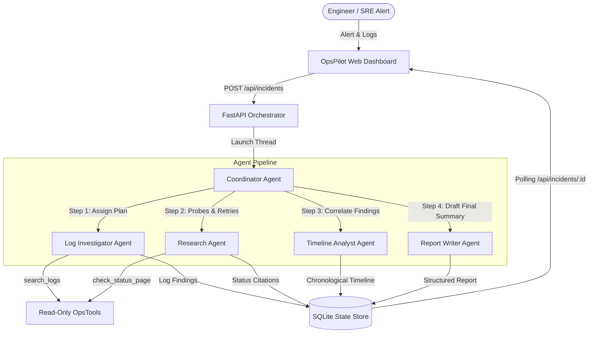

# OpsPilot 🚨
> **Autonomous Multi-Agent Incident Response System for Small Engineering Teams**

When an outage hits, engineering teams waste critical minutes manually digging through fragmented log files, external status dashboards, and deployment histories. **OpsPilot** orchestrates a specialized team of autonomous agents to investigate alerts, execute read-only diagnostic tools, reconcile conflicting signals, and publish evidence-backed incident reports with prioritized next steps.

---

## 🚀 Key Highlights & Philosophy

1. **Strictly Evidence-Backed**: Separates **Verified Facts** (grounded in timestamped logs and probe results) from **Hypotheses** (inferred root causes). OpsPilot **never fabricates citations or claims to have altered systems it did not touch**.
2. **Read-Only Safety Guard**: All agent interactions and diagnostic commands are read-only. OpsPilot does not restart services, execute destructive commands, or modify production infrastructure.
3. **Resilient Agent Execution**: Handles transient failures and unreachable third-party status endpoints gracefully with bounded retry loops without stalling the overall incident pipeline.
4. **Deterministic Demo Mode**: Ready out of the box with realistic seeded scenarios (Checkout API cascade, Auth JWKS failure, Database deadlocks). **No API keys or paid third-party subscriptions required.**

---

## 🤖 The Agent Team

OpsPilot coordinates 5 specialized agents that exchange structured JSON findings:

| Agent | Role | Responsibilities | Assigned Read-Only Tools |
| :--- | :--- | :--- | :--- |
| **Coordinator** | Orchestrator & Planner | Deconstructs incident alerts into a structured 4-phase plan, assigns subtasks, tracks status, and handles agent errors. | Incident State Store, Task Planner |
| **Log Investigator** | Error Pattern Hunter | Scans raw logs for error rates, stack traces, OOMKilled events, and connection pool starvation. | `OpsTools.search_logs()` |
| **Research Agent** | Status & Health Prober | Probes public vendor dashboards (e.g., Stripe, AWS, Cloudflare) and internal endpoints; handles timeouts & retries. | `OpsTools.check_status_page()` |
| **Timeline Analyst** | Chronology & Signal Correlator | Synthesizes timestamps from logs and status changes into an incident sequence; flags uncertainty & conflicting signals. | `OpsTools.align_chronology()` |
| **Report Writer** | Incident Documenter | Compiles executive summaries, separates proven facts from hypotheses, computes confidence scores, and produces P0/P1 non-destructive checklists. | `OpsTools.compile_incident_report()` |

---

## 🏗️ Architecture & Data Flow



---

## ⚡ Quickstart Guide (Run in 60 Seconds)

### Prerequisites
- Python 3.10+ installed

### 1. Clone & Navigate
```bash
git clone <repo_url>
cd project1
```

### 2. Install Dependencies
```bash
pip install -r requirements.txt
```

### 3. Start OpsPilot
```bash
python -m uvicorn app.main:app --host 127.0.0.1 --port 8000
```
Open your browser and navigate to: **`http://localhost:8000`**

---

## 🎯 Demo Acceptance Walkthrough

1. **Select a Demo Scenario**:
   - On the top bar, click any seeded incident button:
     - **Checkout API 500 Spike & Payment Processing Timeouts**
     - **Auth0 / JWT Token Verification Failures**
     - **PostgreSQL Primary High CPU & Replication Lag**
2. **Click "Launch Multi-Agent Investigation"**:
   - Observe the **Coordinator** establish a 4-step execution plan.
   - Watch the **Agent Cards** transition in real time: `IDLE` ➔ `RUNNING` ➔ `COMPLETED`.
   - Inspect the **Live Multi-Agent Event Stream** at the bottom to see agent-to-agent message passing and tool executions.
3. **Graceful Failure Demonstration**:
   - In the **Research Agent** output, notice how the unreachable internal probe (`Internal Legacy Payment Hub`) was caught, retried, and gracefully marked `UNREACHABLE` without crashing the coordinator.
4. **Review the Final Incident Report**:
   - **Executive Summary & Likely Cause**: High-confidence causal diagnosis.
   - **Verified Facts vs. Hypotheses**: Clear boundary between proven signals and working theories.
   - **Chronological Timeline**: Step-by-step reconstruction of the outage onset.
   - **Prioritized Next Steps**: Actionable, read-only diagnostic commands ready for engineers to run.

---

## 🧪 Running Unit & Integration Tests

A comprehensive integration test suite verifies agent coordination, database persistence, and tool resilience:

```bash
python -m tests.test_agents
```

Output:
```text
Testing OpsTools...
 OpsTools.search_logs verified.
 OpsTools.check_status_page verified.
 OpsTools resilient failure probe verified.

Testing Full Coordinator & Multi-Agent Flow...
 Verified all 4 agents executed successfully.
 Verified 34 activity events recorded on telemetry bus.
 Verified structured incident report generated with verified facts, hypotheses, and actions.

ALL BACKEND & AGENT TESTS PASSED!
```

---

## 🛡️ Non-Destructive & Safety Guarantees

- **No Destructive Operations**: OpsPilot will never issue restarts, state deletions, or configuration mutations.
- **Evidence Traceability**: Every event in the timeline links directly to a container log line or an HTTP probe response.
- **Graceful Degradation**: If an external telemetry source is offline, OpsPilot notes the absence and continues the investigation rather than hallucinating status information.

---

## 📁 Repository Structure

```text
├── app/
│   ├── agents.py        # LogInvestigator, Research, TimelineAnalyst, ReportWriter implementations
│   ├── coordinator.py   # Coordinator orchestrator, planning, and agent tracking
│   ├── db.py            # SQLite database schema, persistence, and audit log storage
│   ├── main.py          # FastAPI application & REST endpoints
│   ├── tools.py         # Read-only diagnostic tools (search_logs, check_status_page)
│   ├── data/
│   │   └── scenarios.json # Seeded realistic outage datasets for deterministic demo
│   ├── static/
│   │   └── style.css    # Clean styling and animations
│   └── templates/
│       └── index.html   # Real-time incident response web dashboard
├── tests/
│   └── test_agents.py   # End-to-end integration test suite
├── requirements.txt     # Minimal dependencies
└── README.md            # Documentation and demo guide
```
